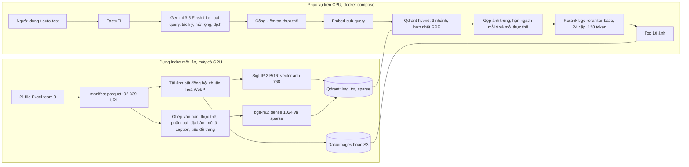
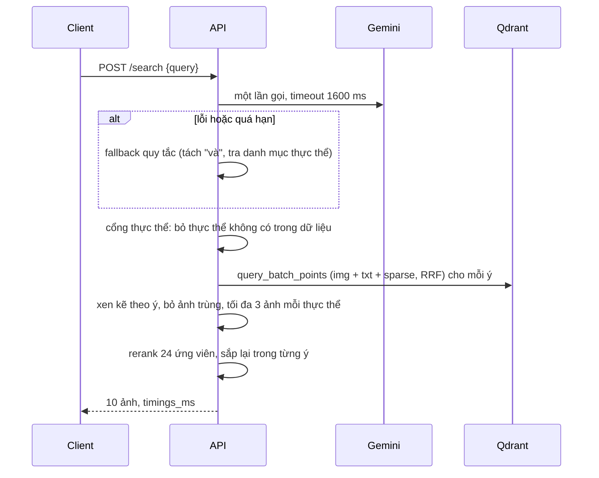

# Kiến trúc hệ thống

## Tổng quan



## Luồng một truy vấn



## Cách xử lý ba loại query

| Loại | Xử lý |
|---|---|
| Một ý | Một đơn vị tìm kiếm. Văn bản SigLIP là bản dịch tiếng Anh, văn bản bge-m3 là câu tiếng Việt cộng thực thể đã kiểm chứng. |
| Nhiều ý | LLM tách thành các ý, mỗi ý tìm riêng rồi xen kẽ vòng tròn để top 10 phủ đủ ý. |
| Suy luận / khái niệm | LLM mở rộng thành tối đa 4 thực thể cụ thể. Cổng kiểm tra giữ lại những thực thể có thật trong dữ liệu; mỗi thực thể trở thành một đơn vị tìm riêng. Nếu không còn thực thể nào thì tìm bằng chính câu truy vấn. |

Lý do chọn hybrid: embedding ảnh không biết tên riêng bản địa (Chiến khu D, địa danh, lễ hội), nên cần thêm chỉ mục
văn bản trên tên thực thể và mô tả ảnh. Số đối chứng ảnh-thuần với hybrid nằm ở `docs/eval-report.md`.

## Schema Qdrant (collection `images`)

```dbml
Table point {
  id uint64 [pk, note: 'int(image_id, 16), image_id = sha1(url)[:16]']
  img vector768 [note: 'SigLIP 2 B/16, cosine, scalar INT8']
  txt vector1024 [note: 'bge-m3 dense, cosine, scalar INT8']
  sparse sparse_vector [note: 'bge-m3 lexical weights']
}
Table payload {
  image_id string
  entity_ids string[]
  entity_names string[]
  caption string
  page_title string
  branch string
  region string
  dup_group string [note: 'đại diện nhóm ảnh gần trùng (pHash Hamming <= 4)']
}
Ref: payload.image_id - point.id
```

## Hạn chế đã biết

- Dữ liệu là di sản và văn hoá Việt Nam, nên truy vấn kiểu "con hổ" ra tranh, linh vật, múa hổ chứ không phải ảnh động vật.
- Quan hệ kiểu "con trai của X" phụ thuộc kiến thức của LLM; cổng chỉ kiểm tra thực thể có tồn tại, không kiểm tra quan hệ đúng.
- Độ trễ Gemini (khoảng 1 giây) chiếm phần lớn ngân sách 3 giây; khi lỗi hệ thống dùng fallback chất lượng thấp hơn.
- Truy vấn không dấu chỉ tốt khi Gemini khôi phục được dấu; fallback không làm được việc đó.
- Endpoint `/demo/search` công khai không bắt khoá, cần giới hạn tần suất trước khi mở ra internet.
