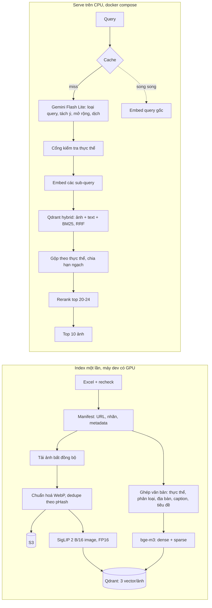

# Thiết kế hệ thống Image Retrieval (Phần B)

Ngày: 2026-10-18. Hạn nộp: 2026-10-22. Làm cá nhân.

## 1. Mục tiêu và tiêu chí thành công

Web demo tìm ảnh theo văn bản tiếng Việt trên tối thiểu 80.000 ảnh, chạy bằng `docker compose`.

| Tiêu chí | Mục tiêu | Cách đo |
|---|---|---|
| Chất lượng | Recall@10 (10 ảnh, chỉ cần 1 ảnh trúng ground truth) | Test set 3 loại query, script `evaluate.py` |
| Latency | < 3 giây cho mỗi query, cả 3 loại, trên toàn bộ index | k6, báo cáo p50/p95/p99 |
| Quy mô | >= 80.000 ảnh index và truy xuất được | Đếm điểm trong index |
| Endpoint | `/search`, `/embed`, `/rerank`, `/healthz`, bảo vệ bằng API key | Auto-test |

Ràng buộc từ đề: bước tìm ảnh chỉ dùng embedding và/hoặc rerank, không dùng agent. LLM dùng Gemini 3.5 Flash Lite, chỉ để xử lý query (và caption lúc index nếu cần). Khi ghi chú mâu thuẫn đề gốc thì theo đề gốc (latency < 3 giây).

## 2. Dữ liệu (đã kiểm tra)

Nguồn: 21 file Excel của team 3 (`Data/incoming/final`, `Data/incoming/recheck`), 11.400 thực thể.

- Ảnh dùng để index: sheet "Ảnh đã thẩm định", lấy nhãn `Giữ/Bỏ` của file recheck mới nhất, nếu chưa recheck thì dùng file final. Ô trống là giữ, `x` là bỏ (đã xác nhận; toàn bộ ảnh đã thẩm định đều đã được duyệt).
- Kết quả: **92.339 URL ảnh khác nhau** được giữ (130.262 cặp thực thể-URL, nên nhiều ảnh gắn nhiều thực thể).
- Không dùng sheet "Ảnh ứng viên" (chưa người duyệt). Không dùng cột "Số ảnh sau verify" (cộng ra 163.910, không khớp dữ liệu).
- Mỗi ảnh đã có: mô tả Gemini Vision, tên thực thể, tiêu đề trang nguồn, tên miền, độ phân giải, pHash, dHash. Mỗi thực thể có: nhánh phân loại, địa bàn, thể loại văn hoá.
- **Chưa biết:** tỉ lệ link ảnh còn sống. Nếu chết quá ~13% thì số ảnh dùng được xuống dưới 80k. Phải đo trước khi chốt.

## 3. Kiến trúc

Container: `api` (FastAPI), `qdrant`, `caddy` (HTTPS, tên miền). Models xuất ONNX INT8 để chạy trên CPU.

## 4. Xử lý ba loại query (một pipeline)

1. **Single:** không tách, search thẳng. Vector query gốc được tính sẵn trong lúc chờ LLM.
2. **Multi-intent** ("hổ và mèo"): LLM tách thành sub-query giữ nguyên bối cảnh chung (địa danh). Mỗi sub-query search riêng rồi xen kẽ, mỗi ý có hạn ngạch ~ 10/số ý trong top 10. Giới hạn 2-3 ảnh mỗi thực thể.
3. **Multi-hop / khái niệm:** LLM mở rộng thành tối đa 4 thực thể cụ thể. Cổng kiểm tra bỏ thực thể không có trong dữ liệu, rồi chạy như multi-intent.

LLM trả JSON ngắn: `qt`, `subs[{vi, en, ents, loc, cat}]`. Không đưa `$schema` vào `response_schema`. Timeout cứng 1,2 giây; khi lỗi hoặc quá hạn thì dùng fallback regex tách " và " cộng tra từ điển thực thể.

Cổng kiểm tra chỉ xác nhận thực thể **tồn tại trong dữ liệu**, không xác nhận quan hệ đúng (ví dụ "con trai ông X"). Vì vậy test set multi-hop phải có người duyệt.

## 5. Ngân sách latency (tất cả là ước lượng, phải đo)

| Bước | Ước lượng p50 / p95 (ms) |
|---|---|
| Cache + chuẩn hoá | 1 / 5 |
| Gemini (song song với embed query gốc) | 450 / 880, timeout 1.200 |
| Kiểm tra thực thể | 2 / 5 |
| Embed sub-query | 35 / 85 |
| Qdrant hybrid | 12 / 28 |
| Gộp + hạn ngạch | 3 / 7 |
| Rerank (INT8, max_len 128, 20-24 cặp) | 290 / 680 |
| Trả JSON | 32 / 100 |
| **Tổng** | **~825 / ~1.790** |

Số này lấy từ báo cáo research; con số thật sẽ được thay bằng kết quả đo trong báo cáo performance.

## 6. Đánh giá

- Test set khoảng 300 query: 100 single, 100 multi-intent, 100 multi-hop.
- Sinh query từ tên thực thể, quan hệ giữa thực thể và danh mục, không sinh từ chính caption đã index (tránh rò rỉ). Multi-hop và một mẫu của hai loại còn lại do người duyệt.
- Chia nhóm theo `entity_id`. Ground truth: ảnh thuộc thực thể (hoặc tập thực thể) được nhắm tới.
- Báo cáo: Recall@10, MRR@10, độ phủ ý với multi-intent, latency p50/p95/p99. So sánh image-only với hybrid để chứng minh lựa chọn bằng số.
- Báo cáo ghi rõ cách tạo test case và hạn chế.

## 7. Vận hành, bàn giao

- Load test k6 tái lập được, tự xuất báo cáo HTML/JSON. Kịch bản có `/search`, `/embed`, `/rerank`.
- Docker multi-stage, healthcheck, nạp index từ snapshot Qdrant. Mục tiêu image nhỏ và khởi động nhanh.
- GitHub Actions: build, test, k6 smoke, deploy qua SSH. Deploy VPS có tên miền là điểm cộng, làm sau khi lõi chạy ổn.
- Tài liệu: sơ đồ kiến trúc, pipeline, schema, lý do chọn, hạn chế. README chạy từ đầu.

## 8. Kế hoạch (xong trước tối 21/10, ngày 22 dự phòng)

| Ngày | Việc bắt buộc | Làm sau nếu còn thời gian |
|---|---|---|
| 18-19/10 | Manifest 92.339 URL; đo tỉ lệ link sống; tải ảnh, dedupe, đẩy S3; embed ảnh và text; nạp Qdrant | Dịch hoặc bổ sung caption cho ảnh thiếu |
| 20/10 | API `/search` `/embed` `/rerank`, Gemini + fallback, hybrid + hạn ngạch, docker compose, UI tối giản | ONNX INT8 tinh chỉnh thêm |
| 21/10 | Test set + `evaluate.py`; k6 + báo cáo; CI; tài liệu; deploy tên miền | Cache ngữ nghĩa |
| 22/10 | Dự phòng, sửa lỗi, nộp bài | |

### Làm nếu còn thời gian (ngoài phạm vi bắt buộc)

Chỉ bắt đầu khi toàn bộ mục bắt buộc ở bảng trên đã chạy được và đã đo xong. Thứ tự ưu tiên giảm dần:

1. Caption bổ sung bằng Gemini cho ảnh thiếu mô tả hoặc mô tả tiếng Anh. Làm khi: Recall@10 ở nhóm query cần caption còn thấp.
2. Cache ngữ nghĩa cho query gần giống nhau. Làm khi: p95 latency còn sát ngưỡng 3 giây hoặc Gemini hay chậm khi load test.
3. `maxsim-cpu` (late-interaction từ bge-m3) làm rerank dự phòng. Làm khi: cross-encoder vượt ngân sách latency.
4. So sánh A/B với ViSigLIP-OT. Làm khi: muốn thêm số liệu cho báo cáo và đã đủ thời gian đo.
5. FormulaQuery của Qdrant (thưởng điểm theo nhánh phân loại) và nén TurboQuant. Làm khi: đã xong mọi thứ trên.

Nếu đến sáng 21/10 mục bắt buộc chưa xong thì các mục này tự động bỏ khỏi phạm vi, và báo cáo ghi rõ là chưa thực hiện.

## 9. Rủi ro chính

| Rủi ro | Cách giảm |
|---|---|
| Link ảnh chết nhiều, dưới 80k ảnh dùng được | Đo sớm; nếu thiếu, hỏi team lead hoặc bù bằng ảnh ứng viên gắn nhãn chưa duyệt |
| Cross-encoder trên CPU vượt ngân sách | INT8, max_len 128, 20-24 cặp; dự phòng bỏ rerank hoặc dùng colbert từ bge-m3 |
| Gemini chậm hoặc lỗi 429 khi load test | Timeout 1,2s, cache LRU, fallback regex |
| LLM bịa thực thể | Cổng kiểm tra thực thể; test multi-hop duyệt tay |
| Một ý chiếm hết top 10 | Hạn ngạch vòng tròn, giới hạn ảnh mỗi thực thể |
| Hết RAM lúc index hoặc serve | Chạy tuần tự từng model trên GPU 4GB; ONNX mmap khi serve |
| Truy vấn mẫu của đề (con hổ, Nha Trang, Phú Quốc) có thể không có trong dữ liệu văn hoá | Tra danh sách thực thể trước khi viết test set |

## 10. Việc còn mở (cần bạn xác nhận)

1. ~~Quy ước ô `Giữ/Bỏ` trống là giữ~~: đã xác nhận.
2. Thông tin S3: tên bucket, vùng, cách cấp quyền. Không gửi key qua chat; đặt trong biến môi trường hoặc file `.env` không commit.
3. Gemini API key (được gửi riêng) cũng đặt trong `.env`.
4. Domain và VPS để deploy: đã có chưa.
5. Số 80k tính theo đâu (nếu link chết làm thiếu ảnh).
